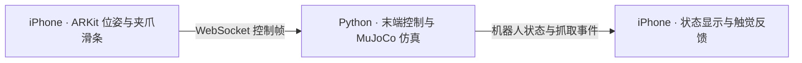

# Franka Teleop

用 iPhone 的 ARKit 六自由度位姿遥操 MuJoCo 中的 Franka Panda。手机通过局域网发送位置、旋转和夹爪开度，仿真端根据双指接触力判定抓取，手机收到抓取事件后触发震动反馈。



## 功能

- 按住遥操按钮时跟随手机的相对位移与旋转，每次按下重新捕获起点。
- 屏幕左侧固定竖向夹爪滑条，向上张开，向下闭合，适合右手侧握时用拇指操作。
- 两侧夹指稳定接触同一方块后触发一次抓取震动，释放后可再次触发。
- 手机最多发送 30 Hz 控制帧，服务端约以 20 Hz 返回机器人状态。
- 松手、追踪异常、应用进入后台或控制数据中断时停止位姿跟随，服务端控制超时为 0.5 秒。
- 支持单操作者连接、序号和输入校验、重连恢复夹爪目标，以及工作空间、关节范围和控制速度限制。

项目面向 MuJoCo 仿真。服务默认监听本机所有网络接口的 TCP 8765，使用明文 WebSocket，未实现身份认证或 TLS，部署范围应限于可信局域网。远程访问需要自行配置认证与加密通道。

## 环境

| 部分 | 要求 |
| --- | --- |
| 仿真主机 | macOS，具备图形界面以运行 MuJoCo 窗口 |
| Python | 3.11、3.12 或 3.13，由 `pyproject.toml` 声明 |
| 依赖管理 | uv，依赖版本由 `uv.lock` 固定 |
| iPhone | iOS 17 或更新版本，支持 ARKit 世界追踪的真机 |
| iOS 构建 | Xcode，包含满足部署目标的 iOS SDK，以及可用于真机运行的开发签名 |
| 网络 | iPhone 与仿真主机在可互通的局域网内 |

开发验证使用 Apple Silicon Mac、Xcode 27.2 和 iPhone SE 第三代。iOS 模拟器无法完成真机 AR 位姿与震动验证。其他平台的图形界面运行尚待验证。

## 启动仿真

安装 uv 后，在克隆或解压得到的项目根目录运行以下命令。[uv 安装文档](https://docs.astral.sh/uv/getting-started/installation/)

```sh
uv sync --frozen
uv run --frozen mjpython -m server
```

首次同步会下载 Python 依赖并创建 `.venv`。Panda 模型及网格已包含在项目中。macOS 也可以双击 `start.command` 启动，它会在项目目录执行相同命令。

MuJoCo 的 macOS passive viewer 需要通过 `mjpython` 启动。[MuJoCo Python 文档](https://mujoco.readthedocs.io/en/stable/python.html)

仅运行物理仿真与网络服务时可使用无窗口模式。

```sh
uv run --frozen python -m server --headless
```

服务端支持以下参数。

| 参数 | 默认值 | 作用 |
| --- | --- | --- |
| `--host` | `0.0.0.0` | 监听地址 |
| `--port` | `8765` | WebSocket TCP 端口 |
| `--headless` | 关闭 | 启用无窗口模式 |

```sh
uv run --frozen mjpython -m server --host 0.0.0.0 --port 8765
```

关闭仿真窗口或在启动终端按 `Ctrl+C` 可结束服务。

## 安装 iPhone 应用

1. 用 Xcode 打开 `ios/FrankaTeleop.xcodeproj`，选择 `FrankaTeleop` scheme。
2. 在 Signing & Capabilities 选择自己的 Team，并将示例 Bundle Identifier 改成自己的唯一标识。
3. 连接、解锁 iPhone，启用开发者模式，选择该手机作为运行目标后运行。
4. 在手机上允许相机和本地网络访问。
5. 查看 Mac 当前局域网 IP，在应用中填写 `ws://<Mac局域网IP>:8765`，将占位文字替换为实际 IP 后点“连接”。

应用会保存填写的地址。Mac 的 IP 或服务端口变化后，需要在应用断开连接时更新地址。手机的 `localhost` 指向手机自身，连接地址应使用 Mac 的局域网 IP。

## 握持与操作

默认坐标适配**右手侧握、屏幕朝身体左侧、手机顶部朝上**。保持这个握姿点一次“重置追踪”，让相机观察光线充足、有纹理的环境，等待“位姿追踪正常”。重置追踪会根据当时的手机朝向重新建立水平坐标轴。

按住底部“按住遥操”后移动或旋转手机，机械臂末端跟随相对变化。松手即可暂停，再次按下会重新捕获手机和末端的参考姿态，便于调整手持位置。

用左侧滑条控制夹爪。上端为 100% 张开，下端为 0% 闭合。滑条在松开遥操按钮时也能控制夹爪，旁边显示目标开度、实际开度和抓取状态。抓住物体后，手机触发一次成功触觉反馈。

服务端以双侧夹指对同一方块的实际法向接触力判定抓取。两侧接触力均超过 0.3 N 且持续 60 ms 时触发抓取事件，双侧接触条件连续失效 100 ms 后触发释放事件。

## 坐标与协议

WebSocket 使用 JSON 文本消息。一个连接同时发送手机控制并接收机器人状态，服务端仅允许一个操作者。

控制帧格式如下。

```json
{
  "type": "control",
  "seq": 1,
  "position": [0.0, 0.0, 0.0],
  "quaternion": [0.0, 0.0, 0.0, 1.0],
  "gripper": 1.0,
  "engaged": true
}
```

| 字段 | 含义 |
| --- | --- |
| `seq` | 同一连接内严格递增的非负整数 |
| `position` | ARKit 世界坐标位置，单位为米 |
| `quaternion` | ARKit 相机姿态，顺序为 `[x,y,z,w]` |
| `gripper` | 目标夹爪开度，范围为 `[0,1]` |
| `engaged` | 是否启用末端位姿跟随 |

按下遥操按钮时，服务端捕获参考位置与姿态。右手侧握的平移映射为 `Δp_robot = [-Δx_AR, +Δz_AR, +Δy_AR]`，对应机器人 +X 向前、+Y 向左、+Z 向上。旋转使用相同映射矩阵 M，按 `M · ΔR_AR · Mᵀ` 变换后作用于参考末端姿态。映射常量位于 `server/simulation.py`。

服务端消息包括以下类型。

| 类型 | 内容 |
| --- | --- |
| `state` | `protocol`、`connected`、`last_seq`、`tracking_active`、`grasped`、`grasp_force`、`gripper`、`gripper_command`、`ee_position`、`target_position`、`joint_positions`、`simulation_time` 和 `message` |
| `grasp` | `grasped` 为抓取或释放状态。抓取时 `force` 为两侧累计法向接触力的较小值，单位为 N，释放事件的值为 0 |
| `error` | `message` 描述非法输入或连接占用原因 |

客户端在收到首个 `state` 后同步 `gripper_command`，再发送控制。控制断流或连接关闭时，服务端保持当前机械臂位置和夹爪目标。工作空间限幅及控制速度参数也位于 `server/simulation.py`。

## 测试

在项目根目录运行自动测试。

```sh
uv run --frozen pytest -q
```

测试覆盖三轴平移与旋转映射、首次按住无跳变、松手与断流保持、输入和序号校验、WebSocket 单操作者及重连保留夹爪目标。物理回归测试使用实际 MuJoCo 接触、重力和摩擦完成下降、夹取、抬升与释放，并验证单侧碰触不会触发抓取事件。

iOS 工程可进行无签名编译检查。将 `DEVELOPER_DIR` 替换成实际 Xcode 安装位置。

```sh
DEVELOPER_DIR=/Applications/Xcode.app/Contents/Developer \
xcodebuild -project ios/FrankaTeleop.xcodeproj -scheme FrankaTeleop \
  -configuration Debug -destination 'generic/platform=iOS' \
  CODE_SIGNING_ALLOWED=NO build
```

## 常见问题

| 情况 | 处理 |
| --- | --- |
| 手机连接失败 | 确认服务已启动，使用 Mac 当前局域网 IP，核对手机本地网络权限、Mac 防火墙和 Wi-Fi 客户端隔离设置。 |
| 提示已有手机连接 | 先在当前操作者应用中断开，再连接另一台手机。 |
| 追踪受限或控制按钮不可用 | 对准光线充足、有纹理的环境，减缓手机移动，等待追踪恢复后重新按住。 |
| 运动方向不符合握姿 | 保持顶部朝上、屏幕朝左的握姿，点“重置追踪”后再开始遥操。 |
| 夹爪闭合但没有震动 | 确认两侧夹指持续夹住方块，并查看应用的抓取状态。空夹和单指碰触不会触发抓取事件。 |
| 重新运行提示端口被占用 | 关闭已有仿真窗口，或用 `--port` 指定其他端口并同步修改手机连接地址。 |

## 项目结构

```text
ios/                     SwiftUI、ARKit 客户端与 Xcode 工程
server/__main__.py       WebSocket 服务、仿真循环与窗口入口
server/simulation.py     MuJoCo 场景、末端控制、坐标映射与抓取判定
server/models/panda/     Panda 模型、网格、来源记录与第三方许可证
tests/                   仿真和网络回归测试
pyproject.toml            Python 依赖与测试配置
uv.lock                  固定的依赖版本
start.command            macOS 启动脚本
```

## 许可证

本项目原创代码采用 MIT License。许可文本位于根目录 `LICENSE`。[项目许可证](LICENSE)

随项目分发的 Franka Panda 模型来自 MuJoCo Menagerie，保留 Apache-2.0 License。第三方归属、固定来源版本以及场景扩展说明见相关文件。[第三方声明](THIRD_PARTY_NOTICES.md) · [模型来源](server/models/panda/SOURCE.txt) · [模型许可证](server/models/panda/LICENSE)
